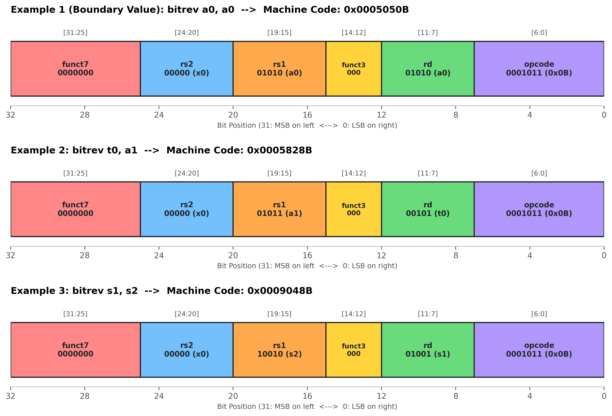
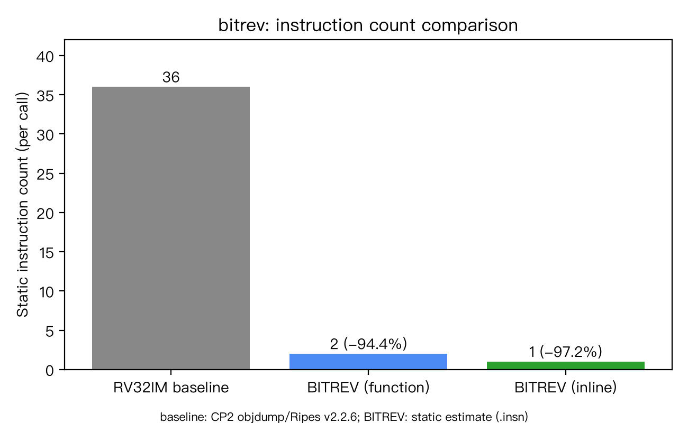

# CP3 — 指令規格與編碼

> 本檔於 CP3 繳交前完成，格式依 HOMEWORK.md 第 5.3 節（六段式）。
> 語意規格撰寫格式見 HOMEWORK.md 第 6.7 節。

## 1. 本次目標

定義 32-bit BITREV 的語意與 R-type 編碼，整合三組機器碼驗證，並在明確區分計數方法與比較範圍下，分析相對於 RV32IM baseline 的指令數差異。

## 2. 設計內容

### 2.1 BITREV 語意規格

依 [HOMEWORK.md](../../HOMEWORK.md) §6.5、§6.7 與 [A 的正式規格](../instructions/BITREV/README.md) 整合；本報告依 §5.3 保留六段式結構。

| 規格項目 | 定義 |
|---|---|
| 指令用途與語意 | 完整反轉 32-bit 位元順序：`rd[i] = rs1[31 − i]`，`i = 0 … 31`；不是只交換 byte 順序 |
| 輸入與輸出 | 一元運算；讀取來源暫存器 `rs1` 的全部 32 位元，結果寫入 `rd`；`rs2` 不使用，編碼固定填 `x0` |
| 運算元與定義域 | 所有 32-bit 位元圖樣，`0x00000000` 至 `0xFFFFFFFF`；有號／無號解讀不影響位元重排結果 |
| 結果範圍 | 所有 32-bit 位元圖樣，`0x00000000` 至 `0xFFFFFFFF`；若解讀為有號數則為二補數範圍 |
| 邊界條件與溢位處理 | 不做算術，沒有溢位、進位或飽和處理；全零、全一反轉後不變；連續反轉兩次得到原值 |
| 暫存器特殊情況 | `rd = x0` 時丟棄結果，`x0` 維持 0；`rd = rs1` 合法，先讀取原值再寫回 |
| 測試向量 | §3.1 的三組輸入／預期輸出與課程指定向量相同，第一組為最低位移至最高位的邊界案例 |
| 對應 baseline 與指令數 | [CP2 RV32IM 程式](../src/rv32im/bitrev.S) 以 16／8／4／2／1 五階段交換位元；運算本體 35 條，加 `ret` 共 36 條，詳見 §2.3 與 §3.3 |

### 2.2 虛擬碼與硬體接線

逐位元版用來描述語意；所有右移都是 **32-bit 無號值的邏輯右移**。先保存來源，可明確表示 `rd = rs1` 時的讀寫順序。

```text
source ← x[rs1]                   // 保存原始 32-bit 位元圖樣
result ← 0
for i ← 0 to 31:
    bit ← (source >> (31 − i)) AND 1
    result ← result OR (bit << i)
if rd ≠ x0:
    x[rd] ← result
// rs2 不使用；x0 不變
```

接線版的 32 個對應同時成立，沒有執行 32 次迴圈的含義：

```text
bitrev_out[0]  ← source[31]
bitrev_out[1]  ← source[30]
…
bitrev_out[30] ← source[1]
bitrev_out[31] ← source[0]
// 一般式：bitrev_out[i] ← source[31 − i]
```

每個輸出只接到一個固定輸入，BITREV 運算本體可用導線重排，不需要 ALU 做遮罩、位移或合併；CPU 仍需要指令解碼、結果選擇及暫存器寫回控制。這是設計說明，並未提供硬體實作或延遲量測。

### 2.3 RV32IM baseline 與自訂指令的差異

[CP1](CP1.md) 的 C baseline 與 [CP2](CP2.md) 的 RV32IM 實作均採五階段交換。以下節錄 CP2 的前兩階段；不是完整函式，後續階段及 `ret` 請見原始碼。

```asm
bitrev:
    # k = 16：交換左右半字，3 條
    slli    t2, a0, 16
    srli    t3, a0, 16
    or      a0, t2, t3
bitrev_step8:
    # k = 8：產生遮罩並交換 byte，8 條
    lui     t1, 0x00FF0
    addi    t1, t1, 0x0FF
    xori    t0, t1, -1
    and     t2, a0, t1
    slli    t2, t2, 8
    and     t3, a0, t0
    srli    t3, t3, 8
    or      a0, t2, t3
```

| 步驟 | baseline 指令數 | 作用 |
|---|---:|---|
| k = 16 | 3 | 兩次位移與一次 OR |
| k = 8、4、2、1 | 8 × 4 = 32 | 每階段 3 條產生遮罩，5 條取位、位移與合併 |
| 返回 | 1 | `ret`，展開為 `jalr` |
| 合計 | 36 | 運算本體為 35 條 |

自訂 BITREV 設計以一條指令表示相同位元重排，取代 12 條遮罩產生及 23 條交換指令；若保留函式形式，另加一條 `ret`。此替代以 CPU 支援該指令為前提。

### 2.4 R-type 編碼與欄位

依 [B 的編碼文件](cp3-b/encoding.md) 與 [分工表](https://hackmd.io/@zfJmm29uSpKJlSmW_p2Tyg/ryE44NC2Gx)，採 32-bit R-type、custom-0 編碼：

```text
31      25 24   20 19   15 14  12 11    7 6       0
+----------+-------+-------+------+-------+---------+
|  funct7  |  rs2  |  rs1  |funct3|  rd   | opcode  |
+----------+-------+-------+------+-------+---------+
```

| 欄位 | 位元範圍 | 寬度 | 固定值／意義 |
|---|---|---:|---|
| funct7 | [31:25] | 7 | `0000000`，由教師分配（HOMEWORK 第 4 節） |
| rs2 | [24:20] | 5 | `00000`，固定填 `x0`，不使用其讀出值 |
| rs1 | [19:15] | 5 | 來源暫存器編號，0 至 31 |
| funct3 | [14:12] | 3 | `000`，由教師分配（HOMEWORK 第 4 節） |
| rd | [11:7] | 5 | 目的暫存器編號，0 至 31 |
| opcode | [6:0] | 7 | `0001011`，custom-0（`0x0B`） |

```text
機器碼 = (funct7 << 25) | (rs2 << 20) | (rs1 << 15)
       | (funct3 << 12) | (rd << 7) | opcode
```

這裡移位的是暫存器「編號」，不是暫存器內的資料；32 位元欄位寬度合計為 `7 + 5 + 5 + 3 + 5 + 7 = 32`。



圖 1：B 提供的編碼欄位圖，來源為 [編碼手算](cp3-b/encoding.md)；由左至右為高位至低位，位元範圍以各欄位上方的 `[31:25]` 等標示為準，下方 32 至 0 刻度表示欄位邊界。圖中的機器碼與 §3.1 及反組譯紀錄一致；此圖不表示 CPU 已支援執行。

## 3. 結果與分析

### 3.1 三組機器碼範例

以下 `bitrev rd, rs1` 為設計的組語表示；既有驗證實際使用 GNU as 的 `.insn r`，沒有證據顯示工具已原生支援 `bitrev` 助記符。暫存器變化均為依 §2.1 語意推導的**預期結果**，不是自訂 BITREV 的 CPU 執行量測。

| 範例 | 組語表示 | 來源／目的編號 | Hex 機器碼 | 預期暫存器變化 | 邊界測試 |
|---|---|---|---|---|---|
| 1 | `bitrev a0, a0` | rs1=x10，rd=x10 | `0x0005050B` | `a0: 0x00000001 → 0x80000000` | 是，唯一的 1 從 bit 0 移至 bit 31 |
| 2 | `bitrev t0, a1` | rs1=x11，rd=x5 | `0x0005828B` | 輸入 `a1=0x0000000F`；預期 `t0=0xF0000000`，a1 不變 | 否，一般圖樣 |
| 3 | `bitrev s1, s2` | rs1=x18，rd=x9 | `0x0009048B` | 輸入 `s2=0x12345678`；預期 `s1=0x1E6A2C48`，s2 不變 | 否，一般數值 |

三組完整欄位及 32-bit 二進位如下；欄位中的空格只用來分隔，不是額外位元。

```text
          funct7  rs2   rs1   f3  rd    opcode
範例 1： 0000000 00000 01010 000 01010 0001011
32-bit：0000 0000 0000 0101 0000 0101 0000 1011
範例 2： 0000000 00000 01011 000 00101 0001011
32-bit：0000 0000 0000 0101 1000 0010 1000 1011
範例 3： 0000000 00000 10010 000 01001 0001011
32-bit：0000 0000 0000 1001 0000 0100 1000 1011
```

funct7、rs2 與 funct3 皆為 0，因此以下由 rs1、rd 與固定 opcode `0x0B` 合成機器碼：

```text
範例 1：(10 << 15) | (10 << 7) | 0x0B
       = 0x00050000 | 0x00000500 | 0x0B = 0x0005050B
範例 2：(11 << 15) | ( 5 << 7) | 0x0B
       = 0x00058000 | 0x00000280 | 0x0B = 0x0005828B
範例 3：(18 << 15) | ( 9 << 7) | 0x0B
       = 0x00090000 | 0x00000480 | 0x0B = 0x0009048B
```

### 3.2 組譯證據與 CPU 執行證據

[B 的測試原始碼](cp3-b/insn-test.S) 包含：

```asm
.text
.insn r 0x0B, 0, 0, a0, a0, x0
.insn r 0x0B, 0, 0, t0, a1, x0
.insn r 0x0B, 0, 0, s1, s2, x0
```

[既有 objdump 紀錄](cp3-b/objdump.txt) 在位址 `0`、`4`、`8` 分別列出 `0005050b`、`0005828b`、`0009048b`，每組為一個 4-byte 指令字，與手算相符。因此可確認既有資料的**組譯與反組譯驗證成功**；本次整合僅核對紀錄，沒有重新執行組譯。

`.insn` 能產生指定欄位的機器碼，不會替 CPU 實作新功能。現有資料沒有自訂 BITREV 的 CPU 實際執行證據，因此**尚未完成自訂 BITREV 的 CPU 執行驗證**；CP1／CP2 的通過紀錄屬於 baseline，不能移用為自訂指令的執行證據。

### 3.3 指令數比較與證據分類

依 [C 的比較文件](cp3-c/instruction-count-comparison.md)、[CP2 報告](CP2.md) 及 [CP2 統計方法](../src/rv32im/instruction-count-results.md) 整合。靜態數是程式中指令位置的個數；動態數是執行經過的指令總數，後者在此另區分核算、推算與模擬實測。

| 版本 | 統計範圍 | 靜態指令數與分類 | 單次核心動態指令數與分類 | 11 次核心動態指令數與分類 | 條件分支 | 方法與工具來源 |
|---|---|---|---|---|---:|---|
| RV32IM baseline 函式 | `bitrev` 至 `ret` | 36：反組譯靜態計數 | 36：固定路徑動態核算 | 396：36 × 11，固定路徑動態核算 | 0 | CP2：GCC 16.2.0、objdump 2.47.20260726；Ripes v2.2.6-106-g5b8a616 僅量到完整程式，非核心區段 |
| BITREV 函式版本 | `bitrev a0,a0` + `ret` | 2：設計推算 | 2：設計推算，非實測 | 22：2 × 11，設計推算 | 0 | B：Binutils 2.47 的單條 `.insn` 紀錄；再加一條 `ret` 推算，沒有完整包裝函式組譯紀錄 |
| BITREV 內嵌版本 | 單條 BITREV | 1：單條指令字有反組譯靜態計數證據 | 1：設計推算，非實測 | 11：1 × 11，設計推算 | 0 | B：Binutils 2.47，三個範例各為一個指令字；沒有 CPU 執行紀錄 |

baseline 核心沒有迴圈或條件分支，每次固定走完 36 條，故 11 次為 396 條；這兩個動態數不是 Ripes 函式區段計數器的讀值。靜態數仍為 36，不會因執行 11 次變成 396。

**CPU 模擬實測的既有數字**是完整 baseline 測試程式的 **6487**，見 [Ripes 原始紀錄](cp2-c/ripes-instruction-count.txt)。它包含核心、呼叫端、測試迴圈與列印，不能納入上述核心成本比較。



圖 2：C 提供的靜態指令數比較圖，數值為 36／2／1，來源為 [比較文件](cp3-c/instruction-count-comparison.md)。baseline 由 CP2 objdump 計數，BITREV 函式為設計推算，內嵌單條由 `.insn` 指令字支持；圖下注明的 Ripes 版本提供 baseline 背景，不能解讀為 BITREV 動態量測工具。

### 3.4 減少比例與比較範圍

```text
指令數減少比例 = (原版本 − 新版本) ÷ 原版本 × 100%
函式對函式： (36 − 2) ÷ 36 × 100% ≈ 94.4%
函式對內嵌： (36 − 1) ÷ 36 × 100% ≈ 97.2%
運算本體：   (35 − 1) ÷ 35 × 100% ≈ 97.1%
11 次比較：  396 → 22 為 94.4%；396 → 11 為 97.2%
```

36 → 2 的兩端都包含 `ret`；36 → 1 除了取代運算，也移除了返回指令，因此不是相同函式形式。35 → 1 才是排除 `ret` 的單純運算本體比較。降低的主要工作是遮罩產生與五輪位移／合併，不能把這些比例直接當作執行時間減少或效能提升比例。

### 3.5 工具版本、假設與限制

| 用途 | 既有工具／設定 | 證據與限制 |
|---|---|---|
| CP2 baseline 靜態計數 | GNU RISC-V GCC 16.2.0、objdump 2.47.20260726；`-march=rv32im -mabi=ilp32` | [核心反組譯](../src/rv32im/instruction-count-objdump.txt)，36 條含 `ret` |
| CP2 baseline 完整程式動態量測 | Ripes `v2.2.6-106-g5b8a616`、`RV32_5S`、RV32IM、`--iret` | [CP2](CP2.md) 與 [計數器紀錄](cp2-c/ripes-instruction-count.txt)，6487 條 |
| CP2 baseline 正確性複查 | GCC 14.2.0、Ripes v2.3.0 | [CP2](CP2.md) 記載 11/11 PASS；與上述計數工具分開列示 |
| CP3-B 編碼驗證 | B README 記載 GNU Binutils 2.47；`riscv64-elf-as`／`riscv64-elf-objdump`，RV32IM／ILP32 | [B README](cp3-b/README.md) 與 [objdump](cp3-b/objdump.txt)；輸出未附版本命令，版本依文件記載 |

- HackMD 的預先驗證另記 GNU as 2.45；本報告將它與 B 文件記載的 2.47 分開，不視為同一次驗證，也不自行補出版本紀錄。
- C 文件說明所用 Ripes 不支援本次自訂 opcode；本報告沒有修改 CPU，BITREV 的動態數均以支援正確解碼與寫回的 CPU 為假設。
- 比較只涵蓋核心；不含呼叫端、載入測資、測試迴圈或列印。11 次是沿用 CP1 的 11 組輸入，不是新增自訂指令實測。
- 內嵌版假設輸入已在暫存器、結果可直接使用，不計額外搬移指令；函式版假設沿用 a0 作輸入／輸出。
- `ret` 計入指令數，但它是返回用的 `jalr`，不列為條件分支。表內 0 指的是條件分支，不表示函式沒有控制流程返回。
- 依 HOMEWORK §5.4，本次不比較 cycle 數；沒有硬體延遲或執行時間數據，不能據指令數推出實際加速比。

## 4. 遭遇的問題與解法

### 4.1 整合過程發現的問題與處理

以下是本次交叉閱讀文件時發現的表述問題，不宣稱為 A／B／C 曾親身遇到的工具故障。

| 問題 | 分析與解決方式 | 驗證依據 |
|---|---|---|
| 靜態計數、動態核算與實測容易混淆 | C 表格將 baseline 方法簡寫為「CP2 實測」，A 的 5 Whys 也使用「核心實測 36 條」；回查較詳細的 CP2 方法後，在本報告拆成靜態 36、動態核算 36／396、完整程式實測 6487 | [CP2 方法](CP2.md)、[統計說明](../src/rv32im/instruction-count-results.md)、[反組譯](../src/rv32im/instruction-count-objdump.txt) |
| 完整程式統計與核心成本不同 | 先界定 `bitrev` 至 `ret` 的範圍，再排除 harness／列印；6487 只作既有模擬背景，不拿來與 BITREV 的 1／2 條比較 | [Ripes 計數器](cp2-c/ripes-instruction-count.txt) 與 CP2 統計範圍 |
| 組譯成功容易被誤認為 CPU 可執行 | 檢查 B 原始碼實際使用 `.insn`，反組譯只顯示指定指令字；把暫存器變化標成預期值，保留 CPU 執行尚未驗證的結論 | [insn-test.S](cp3-b/insn-test.S)、[objdump.txt](cp3-b/objdump.txt)、C 的限制說明 |

處理方式是在主報告補上分類、來源與假設，保留 A／B／C 原始成果不變；沒有為了補報告而新增模擬結果。

### 4.2 5 Whys：為什麼 BITREV 運算本體不需要 ALU？

依 [A 的 5 Whys](../instructions/BITREV/README.md) 整合為以下連續推理；討論範圍是位元重排本體，CPU 的解碼與寫回控制仍然需要：

1. **為什麼不需要 ALU 做位元重排？** 因為每個輸出只是某個輸入位元的副本。驗證：`rd[i] = rs1[31 − i]`，沒有位元值的算術運算。
2. **為什麼每個輸出只需複製一個輸入位元？** 因為語意只指定位置對應，不要求反相或組合其他位元。驗證：公式右側只有 `rs1[31 − i]`。
3. **為什麼這個位置對應能預先固定？** 因為每個輸出位置 i 都唯一對應輸入位置 `31 − i`，與輸入資料無關。驗證：代入 i=0、1、31，來源分別為31、30、0。
4. **為什麼固定對應不需要可變位移或資料選擇？** 因為沒有運算元指定另一種排列方式，rs2 也不使用。驗證：§2.1 的一元規格與 §2.2 的32條固定對應。
5. **為什麼固定傳遞可以用導線完成？** 因為每條連接只需保持0→0、1→1，不需要改變位元值。驗證：導線的恆等傳遞與 §2.2 接線式一致；因此重排本體可直接接線，無須ALU計算。這不代表整個CPU沒有邏輯閘，也不是硬體延遲量測。

## 5. 白話說明

BITREV 像把一排32顆燈左右反排，最低位搬到最高位，亮暗不變。原本程式分五輪交換，加返回共36條；自訂設計用一條反轉，加返回共兩條。整合的難點是來源把不同計數簡稱為實測；回查原始紀錄後，分清核心36／396是核算、完整程式6487才是模擬紀錄。編出機器碼只證明編碼正確，仍不能說CPU已能執行。

## 6. AI 使用說明

依 HOMEWORK §7.3，以下依本次 CP3 分工與學號記錄各組員的 AI 使用情形。CP1／CP2 的 AI 使用見各自報告，不沿用為 CP3 紀錄。

| CP3 組員／學號 | 使用工具 | 使用時機與用途 | 人工檢查或修改內容 |
|---|---|---|---|
| A／1114405020 | Claude Code（模型 Claude Opus 5.5） | 拆分 CP3 四人分工與檔案架構；建立 `instructions/BITREV/README.md` 的 §6.7 骨架，起草語意、邊界條件、測試向量手算、虛擬碼與 5 Whys；以 GNU as `.insn` 組譯核對機器碼；協助審查 PR #11–#13 | 本人提供組名「一群瘋子」與 funct 來源（教師分配），自行查證 RISC-V 規格書頁碼（§2.1 p.14、§2.2 p.16、opcode map p.129）並交由 AI 填入；於網頁上修正中英文姓名間距（commit `62f7920`）；依審查結果決定退回 PR #11 由 B 修正比例與欄位圖位元方向 |
| B／1114405042 | Antigravity AI（Gemini 3.8 Flash，Google DeepMind）；ChatGPT（GPT-4o，OpenAI） | 撰寫 `encoding.md` 時確認 R-type 欄位位移公式與 `.insn r` 語法；核對 3 個範例的十六進位換算；產生 `cp3_encoding_fields.png` 的 Matplotlib 繪圖腳本；PR 推送遇到非快轉時協助處理 Git rebase | 依組長審查意見，將減少比例改為 97.2%（單條 `bitrev`）與 94.4%（含 `ret`）；欄位圖改為 bit 31 在左、bit 0 在右；還原 `CP3.md`，給 D 的段落改放在 `cp3-b/README.md`；以本機 GNU Binutils 組譯 `insn-test.S`，反組譯結果存為 `objdump.txt` |
| C／1114405012 | GitHub Copilot（Copilot SDK in VS Code）；PR #12 的 commit `419546c` 標示 Copilot 為共同作者 | 協助整理 CP3-C 指令數比較文件初稿，包含比較表、減少比例算式、加速來源與假設／限制的文字說明 | 依 CP2 統計資料補上 baseline 數據與工具版本；核對 36→2（94.4%）與 36→1（97.2%）的計算；確認 BITREV 數據是依 `.insn` 指令字數靜態推算、非 Ripes 模擬實測（Ripes 不支援自訂 opcode）；比較圖與最終內容經組員檢查後納入 |
| D／1114405041 | Codex | 整合 `CP3.md` 前盤點 HOMEWORK 規範與 A、B、C 的來源檔案；整合六段式主報告；審查並整理 D 負責的 4 份文件（`CP3.md`、`CONTRIBUTIONS.md`、`report/README.md`、`README.md`）；核對機器碼、靜態／動態計數分類、檔案路徑與 Git diff | 指定保留 A、B、C 的正確內容；要求區分實測數字與推算數字（BITREV 為靜態推算）；缺少證據處保留 TODO，不讓 AI 自行補寫 |

A、C 列依各組員提供的紀錄填寫；B 列依 B 的 AI 使用紀錄與 PR #11 的修改內容整理；D 列依 D 於 PR #13 留下的紀錄整理。
